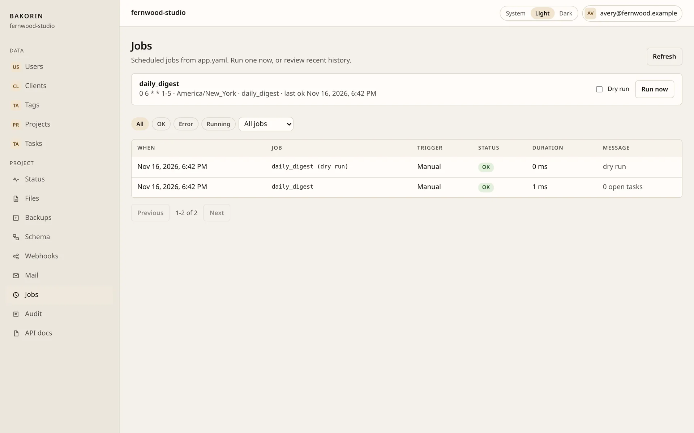

# Jobs

Define cron jobs in `app.yaml` and implement them in `hooks.ts`. Bakorin runs each due slot once, records the result, and shows the history in the admin. Admins can also run a job immediately.



## Configure a job

```yaml
jobs:
  - name: refresh_stats
    cron: "0 */6 * * *"
    timezone: America/New_York
    # handler: refresh_stats   # defaults to the job name
    # dryRun: false
    # timeoutSeconds: 300
    # enabled: true

runtime:
  jobs:
    retainDays: 30
```

| Key | Default | Notes |
|---|---|---|
| `name` | | Unique identifier. Letters, digits, and underscores only. |
| `cron` | | Five fields: minute hour day-of-month month day-of-week. |
| `handler` | the job name | Key in `hooks.jobs`. |
| `timezone` | `UTC` | IANA name such as `America/New_York`. |
| `dryRun` | `false` | Passed to the handler as `ctx.dryRun` on scheduled runs. |
| `timeoutSeconds` | `300` | 1 to 86400. A run that overruns is marked as an error. |
| `enabled` | `true` | Disabled jobs are skipped by the scheduler. An admin can still run them. |

`runtime.jobs.retainDays` (or `BAKORIN_JOBS_RETAIN_DAYS`) is how long finished runs are kept. The default is 30 days. `jobs` is also reserved as an entity name, because `/api/v1/jobs` is a built in route.

## Cron expressions

The schedule is a standard five field expression:

```
minute  hour  day-of-month  month  day-of-week
```

Supported syntax:

- `*` for every value
- lists (`1,15`), ranges (`mon-fri`), and steps (`*/5`, `0-30/10`)
- month and weekday names (`jan`, `sun`)
- `0` or `7` for Sunday

When both the day-of-month and the day-of-week are restricted (not `*`), a time matches if either field matches. That is the usual Vixie cron rule. Examples:

| Expression | Meaning |
|---|---|
| `*/5 * * * *` | Every five minutes |
| `0 9 * * 1-5` | 09:00 on weekdays |
| `0 0 1,15 * *` | Midnight on the 1st and 15th |
| `0 12 15 * 1` | 12:00 on the 15th, and also every Monday at 12:00 |

Times are evaluated in the job's timezone, including daylight saving. A time that does not exist (the spring-forward gap) is skipped. The next valid slot runs instead.

## Write the handler

Point `runtime.hooks` at `hooks.ts` (the default is `./hooks.ts`) and export a `jobs` map. The key is the handler name from `app.yaml`.

```ts
import type { BakorinHooks } from "@bakorin/server";

const hooks: BakorinHooks = {
  jobs: {
    async refresh_stats(ctx) {
      if (ctx.dryRun) {
        ctx.log("would refresh stats");
        return { ok: true, message: "dry run" };
      }
      // use ctx.db, ctx.mail, ctx.signal, ctx.log
      return { ok: true, message: "updated" };
    },
  },
};

export default hooks;
```

The handler receives:

| Field | Meaning |
|---|---|
| `name` | Job name from `app.yaml` |
| `handler` | Handler key |
| `dryRun` | Honor this and skip side effects |
| `trigger` | `scheduled` or `manual` |
| `scheduledFor` | The cron slot instant, or `null` for a manual run |
| `actor` | The admin who clicked Run now, or `null` for the scheduler |
| `db` | The Kysely database |
| `mail` | Queue mail through the outbox, same as entity hooks |
| `ast` | The compiled schema |
| `projectDir` | Project folder |
| `env` | Process environment |
| `log(message)` | Append a line to the run log (also printed in the server log) |
| `signal` | Aborted when the run times out |

Return `{ ok, message?, data? }`, or return nothing for success. Throw or return `{ ok: false }` to mark the run as an error. `data` must be JSON serializable; it is stored on the run row.

If `hooks.jobs` does not define the handler, the run fails with a clear error and the next slot (or a manual run) can try again.

## How runs are scheduled

The server ticks about every 15 seconds (`BAKORIN_JOBS_TICK_MS` in tests). For each enabled job it looks at the latest cron slot at or before now. If that slot is after the previous tick and has no row yet, it runs the handler once. Missed slots while the process was down are not all replayed; only the latest due slot since the last tick runs. A fresh database does not backfill historical slots.

A unique constraint on `(job_name, scheduled_for)` and a lease (`job-run:{name}`) keep two instances from running the same job at the same time. A failed scheduled run does not retry that slot. Wait for the next slot, or use Run now.

## Admin and CLI

**Jobs** in the admin sidebar is admin only. It lists each job, its last run, and a **Run now** button with a dry run checkbox. The table below is the run history, which you can filter by status and job.

CLI:

```
bakorin jobs list
bakorin jobs run refresh_stats
bakorin jobs run refresh_stats --dry-run
```

Admin HTTP API (all admin only):

- `GET /api/v1/jobs`
- `GET /api/v1/jobs/runs`
- `GET /api/v1/jobs/runs/:id`
- `POST /api/v1/jobs/:name/run` with an optional `{ "dryRun": true }` body

Job run history is included in portable backups.

## Config builder

The in-browser config builder can add and edit jobs, and it keeps them when you import an existing `app.yaml`.
