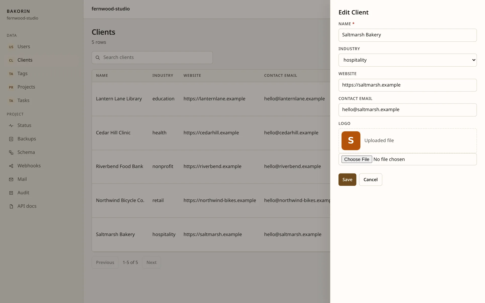
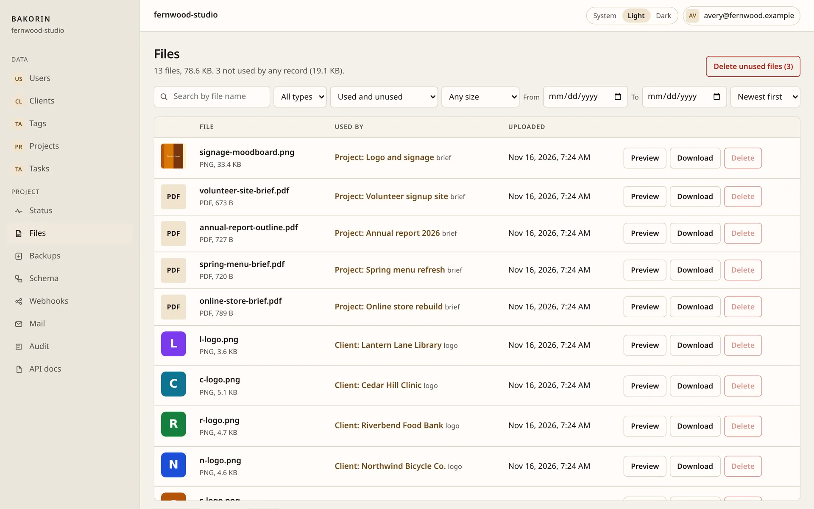
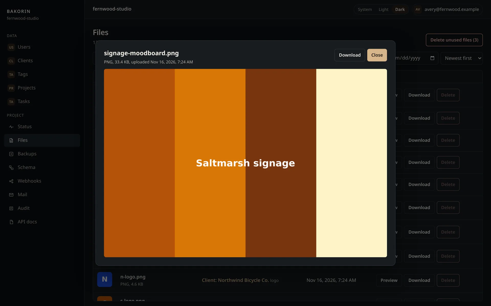

Signed in users can upload files. Files are stored on local disk or in an S3 compatible bucket (Railway buckets, Cloudflare R2, MinIO), and downloads always use a short lived signed URL.



## Configure

```yaml
runtime:
  files:
    driver: local          # or s3
    path: ./data/uploads
    maxBytes: 10485760     # 10 MiB
    allowedMimeTypes: [image/png, image/jpeg, application/pdf, text/plain]
    signedUrlTtlSeconds: 900
```

Defaults: 10 MiB, PNG, JPEG, WebP, GIF, PDF, and plain text, and 15 minute signed URLs. Set `allowedMimeTypes: ["*"]` to allow any type.

Setting a bucket in the environment (`BUCKET` or `S3_BUCKET`) switches the driver to `s3`. See [Configuration](/docs/configuration/) for S3 variables. For Railway buckets set `S3_ADDRESSING_STYLE=path`.

## Upload

Send a multipart form with a `file` field:

```bash
curl -X POST http://127.0.0.1:4371/api/v1/files \
  -H "authorization: Bearer $ACCESS_TOKEN" \
  -F file=@brief.pdf
```

```json
{
  "data": {
    "id": "...",
    "key": "....pdf",
    "filename": "brief.pdf",
    "contentType": "application/pdf",
    "size": 48213,
    "url": "/api/v1/files/...?exp=...&sig=...",
    "downloadUrl": "/api/v1/files/...?exp=...&sig=...&download=1",
    "expiresAt": 1763236800
  }
}
```

Uploads over `maxBytes` or with a type that is not allowed return 400. Signed out callers get 401. A PNG, JPEG, GIF, WebP, or PDF whose bytes do not match its declared type is refused with 400.

Downloads of images, PDF, and plain text open inline, and only pages on the same origin (the admin preview) may frame them. Every other type, including HTML and SVG, downloads as an attachment with `Content-Security-Policy: sandbox` and `frame-ancestors 'none'`, so an uploaded page cannot run script on your API or admin origin even with `allowedMimeTypes: ["*"]`. Add `&download=1` to any signed link (or use `downloadUrl`) to always download. All downloads send `X-Content-Type-Options: nosniff`.

## Attach to a record

Add a `file` field to an entity and store the file id in it:

```yaml
leads:
  fields:
    brief: { type: file, description: Optional brief or attachment. }
```

```bash
curl -X PATCH http://127.0.0.1:4371/api/v1/leads/$LEAD_ID \
  -H "authorization: Bearer $ACCESS_TOKEN" \
  -H "content-type: application/json" \
  -d '{"brief": "<file id>"}'
```

A file field only takes the id of an uploaded file. A signed in user can attach files they uploaded; an admin can attach any file. Keeping the file a record already has is always allowed, so editing other fields never trips on a file someone else attached. Send `null` to remove it.

Sending back a record you loaded is fine: `id`, `createdAt`, `updatedAt`, and other locked fields are ignored when they still hold the stored value, and refused with 403 when they change.

## Show a file

Read the record with `expand` on the file field. It returns the file's details and short lived links, without a second call:

```http
GET /api/v1/leads/:id?expand=brief
```

```json
{
  "data": {
    "id": "...",
    "brief": "6f1c...",
    "$expand": {
      "brief": {
        "id": "6f1c...",
        "filename": "brief.pdf",
        "contentType": "application/pdf",
        "size": 48213,
        "url": "/api/v1/files/6f1c...?exp=...&sig=...",
        "downloadUrl": "/api/v1/files/6f1c...?exp=...&sig=...&download=1",
        "expiresAt": 1763236800
      }
    }
  }
}
```

List calls take the same `expand`. Reading the record is what grants the link, the same as any other field: anyone who may read the record (and the field) gets a link that works for `signedUrlTtlSeconds`. Links expire, so store the file id, never the URL.

With the SDK:

```ts
const file = await api.files.upload(input.files[0]);
await api.entity("leads").update(leadId, { brief: file.id });

const lead = await api.entity("leads").get(leadId, "brief");
lead.$expand.brief?.url;          // show it
lead.$expand.brief?.downloadUrl;  // save it

const fresh = await api.files.sign(file.id); // a new link later
```

The SDK turns the links into full URLs on your `baseUrl` (or the pass through route in the browser).

## Download

`GET /api/v1/files/:id?exp=...&sig=...` serves the file only with a valid signature. Session cookies are not enough. To get a fresh link:

```http
POST /api/v1/files/:id/sign
```

Only the uploader or an admin can sign a file. The answer has the file's name, type, size, `url`, and `downloadUrl`.

## In the admin

The record editor shows the file a record already has: a thumbnail for images, the type for everything else, the name and size, and Open, Download, Replace, and Remove. A new or removed file is saved to the record when you click Save. Lists show the file name with a small preview.

## Files page



**Files** in the admin sidebar (admins only) lists every upload:

- Search by file name, and filter by type (images, PDF, text, other), size, upload date, and whether a record uses it.
- Preview images and PDFs in place, or download any file. Previews and downloads use the same signed links as the API, so the inline and attachment rules above still apply.
- See which records use each file, with a link that opens the record.
- Delete files no record uses. One at a time, or **Delete unused files** for all of them. Both ask for confirmation, and every deletion is written to the audit log (`file_delete`, with the file name, type, and size). Uploads from the last hour are kept by the bulk delete, in case their form is still open. Files used by a record cannot be deleted: remove them from the record first.



A file counts as used while any record holds its id, including a field you removed from `app.yaml` but whose data is still kept (see [Schema changes](/docs/migrations/)), so re-adding that field brings its files back too.

There are no folders: files belong to records, and the record is where you organize them.

The same list is available to admin tokens:

| Route | What it does |
| --- | --- |
| `GET /api/v1/files` | List uploads. Query: `q`, `type` (`image`, `pdf`, `text`, `other`), `minSize`, `maxSize` (bytes), `from`, `to` (`YYYY-MM-DD`), `status` (`used`, `orphaned`), `ids`, `sort` (`createdAt`, `size`, `filename`, `-` for descending), `limit`, `offset`. Each file has `usedBy`, `orphaned`, `url`, and `downloadUrl`. |
| `DELETE /api/v1/files/:id` | Delete one file no record uses. 409 with `usedBy` when a record still uses it. |
| `POST /api/v1/files/orphans/delete` | Delete every unused file older than an hour. |
