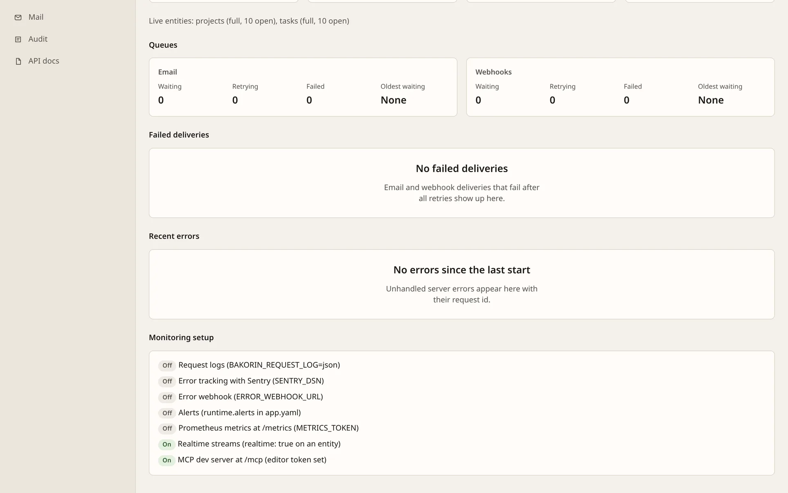

Bakorin can expose a small, read only [Model Context Protocol](https://modelcontextprotocol.io) server so your AI coding tool understands your backend while you build the front end. It is off by default.

## Turn it on

```yaml title="app.yaml"
runtime:
  mcp: true # or { enabled: true, sampleLimit: 5 }
```

Or set `BAKORIN_MCP=true` (which also wins over `app.yaml` when set to `false`).

Then create a token of at least 32 characters for your editor and put it in the project's `.env`:

```bash title=".env"
BAKORIN_MCP_TOKEN=paste-a-long-random-string-here-0123456789
```

A shorter token is ignored with a warning. An admin's access token works too.

## What it offers

The endpoint is `POST /mcp` (JSON-RPC over Streamable HTTP). Every tool is read only:

| Tool | Returns |
|---|---|
| `app_overview` | App name and version, database dialect, auth settings, entities with record counts, and which features are on |
| `list_entities` | Every entity with its label, field names, read policy, and realtime mode |
| `describe_entity` | Fields with types, required, unique, defaults, enum values, relations, private and secret flags, plus policies, indexes, and rate limits |
| `list_policies` | Every entity's read, create, update, and delete rules in plain words |
| `get_openapi` | The generated OpenAPI document |
| `get_typescript_types` | The same interfaces as `bakorin typegen` |
| `sample_records` | The newest few records of one entity (secret fields removed), capped by `sampleLimit` |

It never writes, never returns password hashes or secret fields, and every call is written to the audit log as `mcp.call`. Calls without a valid token are refused, rate limited, and logged as `mcp.denied`. Browser requests from origins outside `CORS_ORIGINS` are refused.



## Cursor

```json title=".cursor/mcp.json"
{
  "mcpServers": {
    "bakorin": {
      "url": "http://127.0.0.1:4371/mcp",
      "headers": { "Authorization": "Bearer ${env:BAKORIN_MCP_TOKEN}" }
    }
  }
}
```

## Claude Code

```bash
claude mcp add --transport http bakorin http://127.0.0.1:4371/mcp \
  --header "Authorization: Bearer $BAKORIN_MCP_TOKEN"
```

## Claude Desktop

Claude Desktop starts local servers as commands, so bridge to the HTTP endpoint with `mcp-remote`:

```json title="claude_desktop_config.json"
{
  "mcpServers": {
    "bakorin": {
      "command": "npx",
      "args": ["mcp-remote", "http://127.0.0.1:4371/mcp", "--header", "Authorization:${AUTH}"],
      "env": { "AUTH": "Bearer paste-your-token-here" }
    }
  }
}
```

## In production

Leave it off. It is meant for local development. If you turn it on in production, Bakorin prints a warning at boot, and the token should be treated like an admin password because it can read your schema and sample records.
