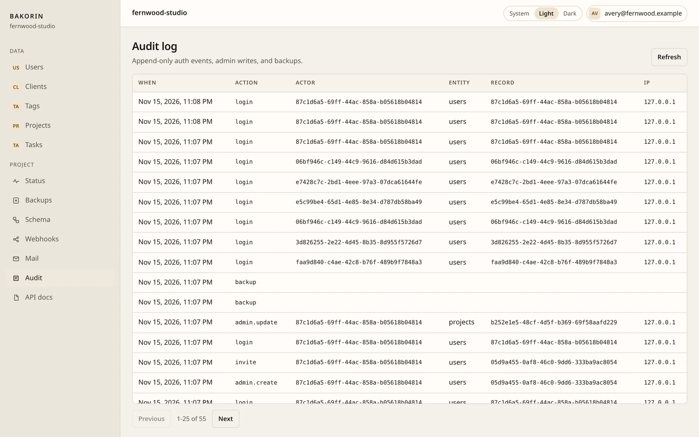

- SQL is parameterized. Table and column names come from the compiled schema and are identifier checked.
- The auth `role` field is admin only on every write path. `/auth/signup` ignores a client supplied role and always assigns the non admin default.
- Ownership fields cannot be taken over. A non admin who sends `ownerId` gets 403. `owner()` row filters keep another user's row at 404.
- Password updates through CRUD require an admin, or the current password for self service, and are always hashed with argon2id.
- Access JWTs last 15 minutes. Refresh tokens are stored as SHA-256 hashes, rotated atomically on use, and reuse more than 30 seconds after a rotation revokes every token for that user.
- Auth routes are rate limited per client IP in the database. The IP is the socket address unless `TRUST_PROXY` says a proxy is in front, so a client cannot dodge limits by sending its own `X-Forwarded-For`. Five failed logins lock the account with backoff. A site in front sends the visitor IP with `BAKORIN_PROXY_SECRET`, and Bakorin trusts that IP only when the secret matches.
- `bakorin start` refuses to boot without a `JWT_SECRET` of at least 32 characters that is not a placeholder. The built in development secret is used only by `bakorin dev` and tests. `JWT_SECRET_PREVIOUS` supports rotation and gets the same check.
- Access tokens are checked against the database on every request: deleted users, role changes, password resets, and logout everywhere take effect at once. Refresh rotation is atomic, with a 30 second grace window for parallel requests.
- Request bodies are capped: 1 MiB for JSON, and `files.maxBytes` plus framing for uploads. Larger bodies get 413.
- Uploaded HTML, SVG, and other active types download as sandboxed attachments. Declared image and PDF types must match their bytes.
- A client can only point a relation at a record it can read.
- In production the first admin needs the env seed or a one time setup token from the server log.
- Entities can set `rateLimit` per action, uploads can set `runtime.files.rateLimit`, and a `verify` hook can require a captcha on signup and public creates.
- Login lockouts are per email and client IP, and unknown emails look the same as wrong passwords.
- `/api/v1/openapi.json` is admin only in production unless `runtime.apiDocs: public`.
- `bakorin restore --discard-pending` drops queued mail and webhooks so a staging copy of production cannot email customers.
- Signup answers 202 with the same body for new and existing emails and never returns a session, so it does not reveal who is registered. Login runs the same password check and lockout for unknown emails.
- Signup follows `auth.signup` (`open`, `invite`, or `closed`). Apps whose users `create` policy is not public are invite only unless they opt in.
- Ordinary users never see another user's email, role, or verification status. Those fields are private to the user and admins, and the default users read policy is `[owner(id), admin]`.
- Webhook, mail rule, and audit rows are written in the same database transaction as the record change, so a change is never saved without them, and a failed outbox write rolls the change back.
- A throwing `after*` hook, or any other stray error after a response, is logged with the request id and reported to error monitoring. It does not stop the server.
- Production refuses CORS origin `*` unless `BAKORIN_ALLOW_ANY_ORIGIN=true`.
- File downloads need a short lived signed URL. Upload size and MIME types are set in `app.yaml`.
- The admin UI and API docs send `Content-Security-Policy` (including `frame-ancestors 'none'`), `X-Content-Type-Options: nosniff`, `Referrer-Policy: no-referrer`, and HSTS on HTTPS.
- The admin UI shows non-admins an Admins only screen instead of the dashboard, and the admin endpoints (`_meta`, backups, audit, webhooks, invites) return 403 to them.
- An append only audit log records signup, login, failed login, reset, invite, role change, admin writes, and backups. `GET /api/v1/audit` is admin only.
- Webhook payloads strip secret fields, including password hashes, and signatures cover the timestamp to block replays.
- Webhook delivery and scheduled backups take a database lease so a second instance does not double run.
- `MAIL_DRIVER=resend` without `RESEND_API_KEY` refuses to start.
- The schema copy stored in the database and in backups has JWT secrets, bucket keys, the database password, and the alert webhook replaced with `[redacted]`.
- Backup downloads are admin only. The admin gets a link that works for 60 seconds for one backup, and the server checks again that the person is still an admin before it streams the file. There are no public backup URLs.
- `bakorin restore` checks each file's sha256 before it changes anything, and takes a safety backup first.
- Request logs and error reports leave out query strings, headers, bodies, and tokens. Error messages are scrubbed of email addresses and token looking strings. `/metrics` is off unless `METRICS_TOKEN` is set.

## Audit log

Logins, failed logins, resets, invites, role changes, admin writes, backups, and MCP calls are written to an append only audit log. Admins read it on the **Audit** page.

## Jobs

Scheduled jobs run with no user actor. Manual Run now runs as the signed in admin. Only admins can list runs or start a job. Job handlers are your TypeScript; treat them like other hooks and do not log secrets.
