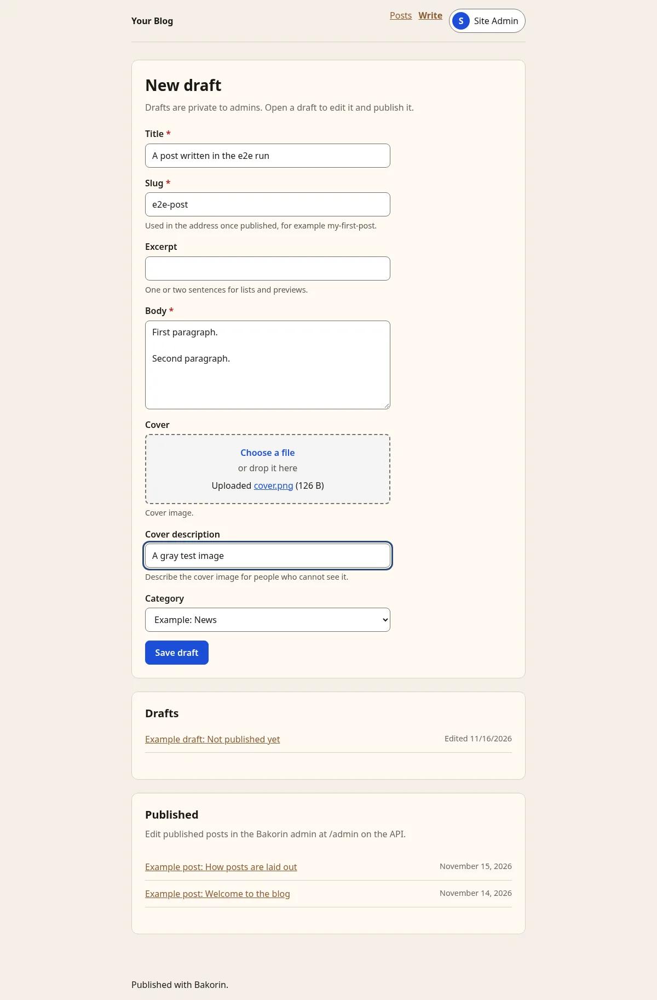
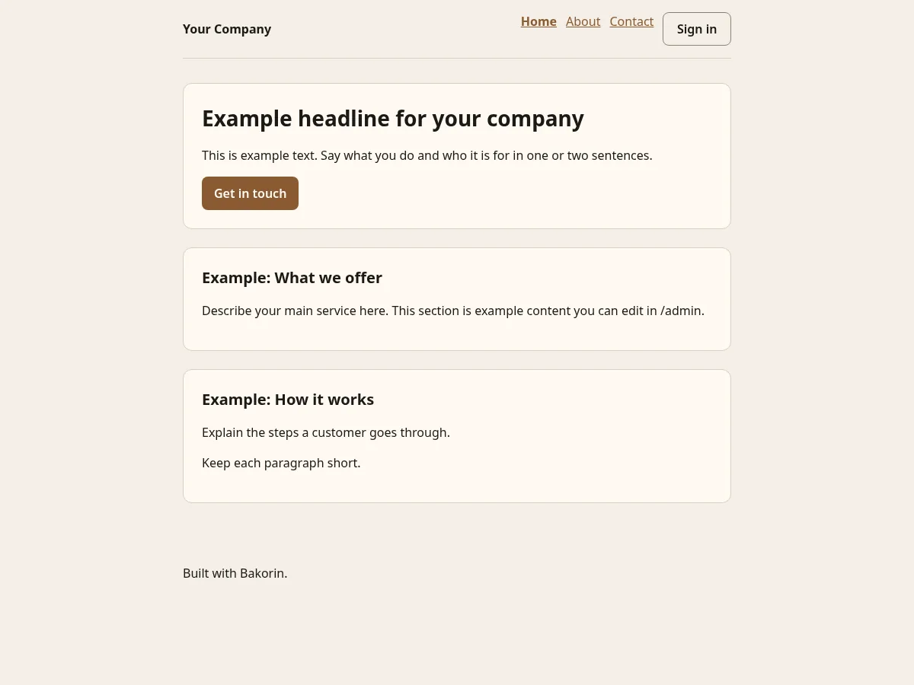
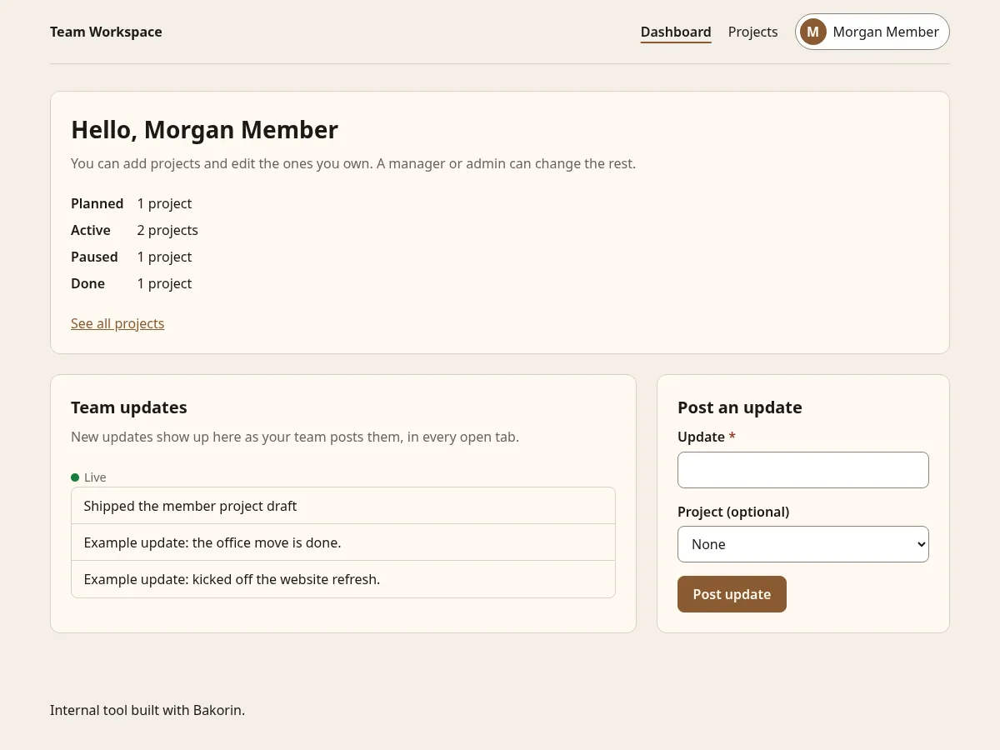
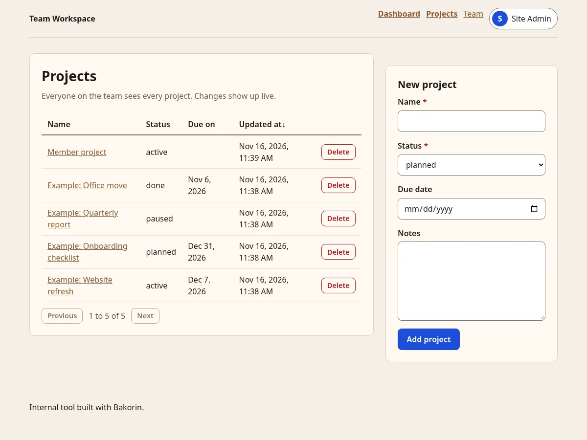

import { Aside } from "@astrojs/starlight/components";

`create-bakorin` can start a project from one of four templates. Each one has its own `app.yaml`, generated types, pages built with the [components](/docs/components/), and a `seed.ts` that loads example data. The same template works with `--frontend astro` and `--frontend next`.

```bash
bun run create my-blog --frontend astro --template blog --yes
bun run create my-site --frontend next --template marketing --yes
bun run create my-tool --frontend astro --template saas --yes
bun run create my-shop --frontend next --template store --yes
```

| Template | Aliases | What you get |
|---|---|---|
| `blog` | | Posts, categories, private drafts, cover images |
| `marketing` | `site`, `marketing-site` | Page sections and a contact form that saves leads |
| `saas` | `internal`, `internal-tool`, `app` | Team projects, live updates, member, manager, and admin roles |
| `store` | `shop`, `ecommerce`, `ecom` | Products with photos, a cart, orders, and a checkout placeholder |
| `todo` | | A private task list (the default, used by the example starters) |
| `auth-only`, `blank` | | Users and account pages only |

## Example data

Each of the four templates ships a `seed.ts`. Put an admin's email and password in `BAKORIN_ADMIN_EMAIL` and `BAKORIN_ADMIN_PASSWORD` in `.env`, start the API, then run it from the project folder:

```bash
bun seed.ts
```

Every record it adds is labeled as example data (titles start with "Example"), and images are plain striped placeholders. Running it twice adds nothing new. Edit or delete the examples before you launch.

<Aside type="note">
The store's example products have no prices. Set real prices on the Manage page. A product without a price shows "Price not set" and is left out of totals.
</Aside>

## Blog

Posts and categories are public. Drafts are a separate entity that only admins can read, so an unpublished post can never leak through the API. Admins write at `/write`, upload a cover image, and press **Publish**, which copies the draft into `posts` with today's date and removes the draft. Signup is `invite`: readers do not need accounts.




| Path | What it does |
|---|---|
| `/` | Published posts with cover images |
| `/posts/:slug` | One post |
| `/categories/:slug` | Posts in a category |
| `/write` | Admins: new draft, drafts, published posts |
| `/write/:id` | Admins: edit, publish, or delete a draft |

Edit a published post in the admin UI at `/admin` on the API.

## Marketing site

Page content lives in `sections` (page, position, heading, body, and an optional button). The contact form saves to `leads`, which anyone can create (five per ten minutes per visitor) and only admins can read. Signup is `invite`; invite teammates from the admin UI.




| Path | What it does |
|---|---|
| `/` and `/about` | Sections for that page, in order |
| `/contact` | Contact form, saved as a lead |
| `/app/leads` | Admins: the leads, newest first |

## SaaS and internal tool

Everyone signed in sees every project. Members edit the projects they own; managers and admins edit and delete any project; admins also see the Team page. The dashboard is behind a `Gate` and shows project counts and a live list of team updates. The projects table and form share one live collection, and each name links to its edit page.





| Path | What it does |
|---|---|
| `/app` | Dashboard: project counts, live team updates |
| `/app/projects` | Projects table and form (live) |
| `/app/projects/:id` | Edit a project |
| `/app/team` | Admins: everyone and their role |

Change a person's role (`member`, `manager`, `admin`) in the admin UI.

## Store

Products and their photos are public. Signed in shoppers add products to a private cart and place an order. The order's lines and total are `writable: none`, so a shopper cannot set them: `hooks.ts` copies the cart into the order with the current prices right after it is saved, then empties the cart. Admins add and edit products at `/manage`.


| Path | What it does |
|---|---|
| `/` | Products |
| `/products/:slug` | One product, add to cart |
| `/cart` | Cart and Place order |
| `/checkout/:id` | Order summary and the payment placeholder |
| `/orders` | Your orders |
| `/manage` | Admins: add and edit products |

<Aside type="caution" title="No payments yet">
The store does not take payments. The checkout page is a clearly marked placeholder and orders stay "Waiting for payment". To add a provider, create its checkout session for the order on the server and let the provider's webhook mark the order paid. Only the server should set the status and amount.
</Aside>

## Change a template

- Site name, header links, protected paths, and where people land after signing in are in `lib/site.ts` (Next) or `src/lib/site.ts` (Astro).
- After you change `app.yaml`, regenerate the types: `bunx bakorin typegen -o web/src/lib/bakorin.gen.ts` (Astro) or `-o web/lib/bakorin.gen.ts` (Next).
- Each project's `web/README.md` lists its pages.
