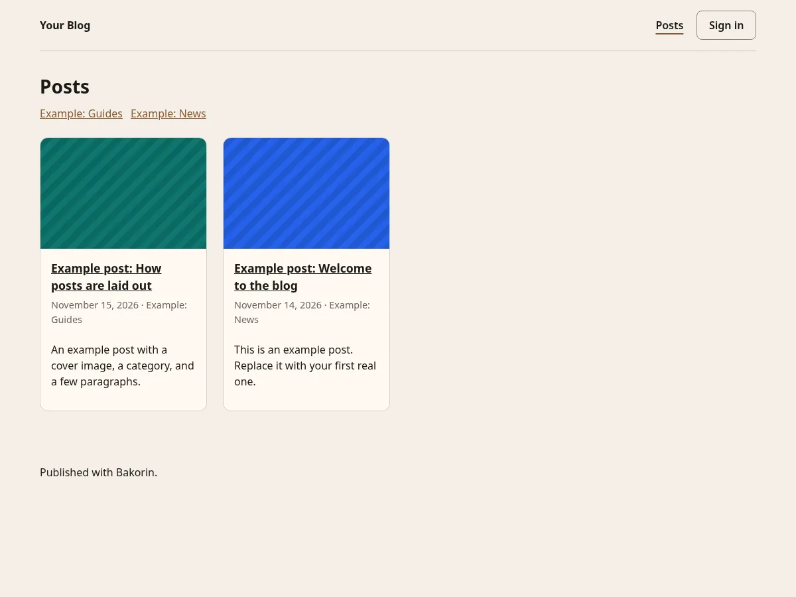
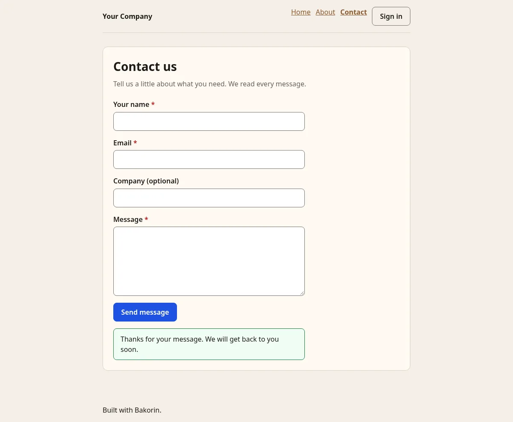
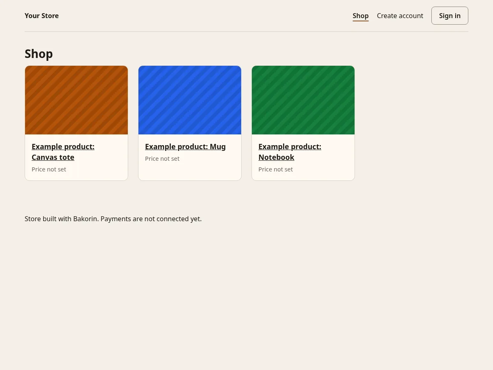
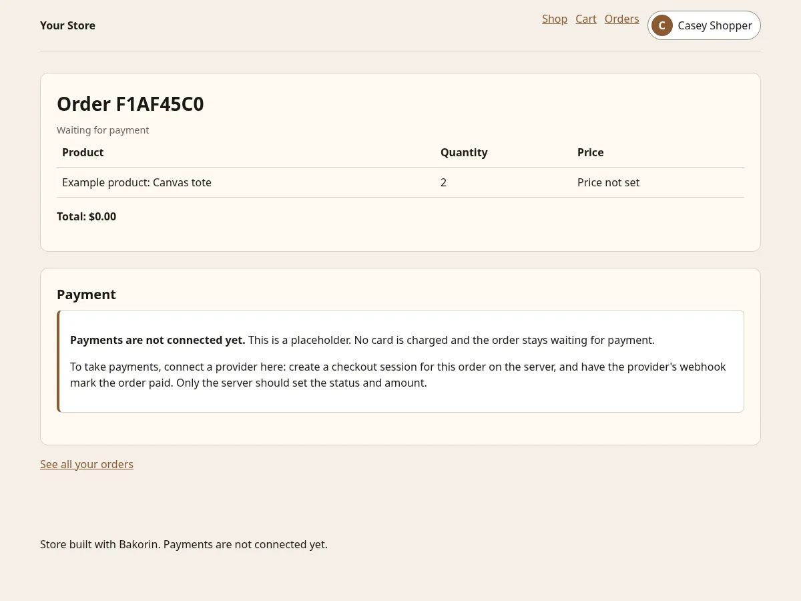
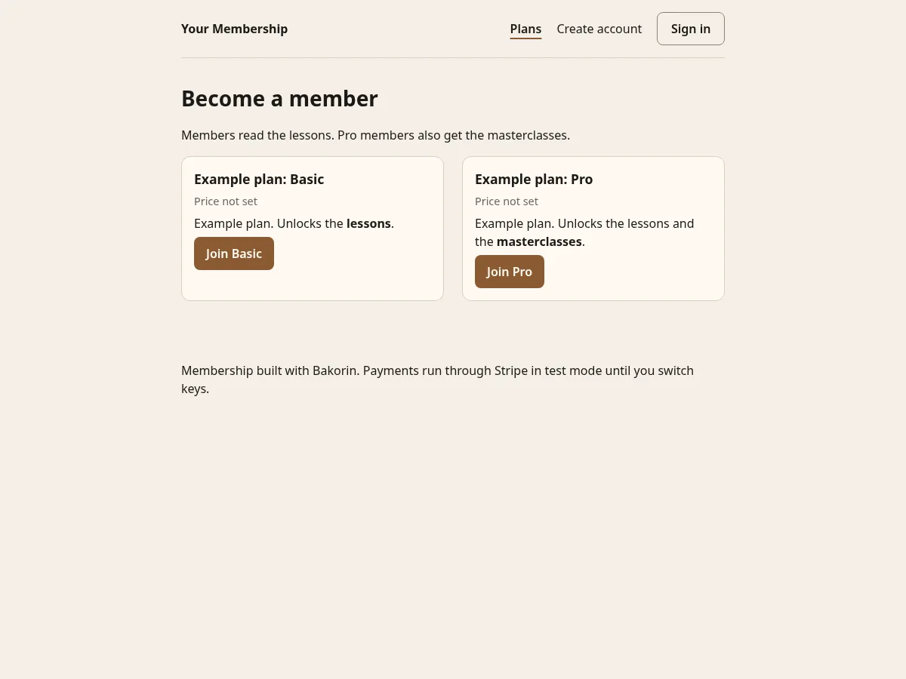
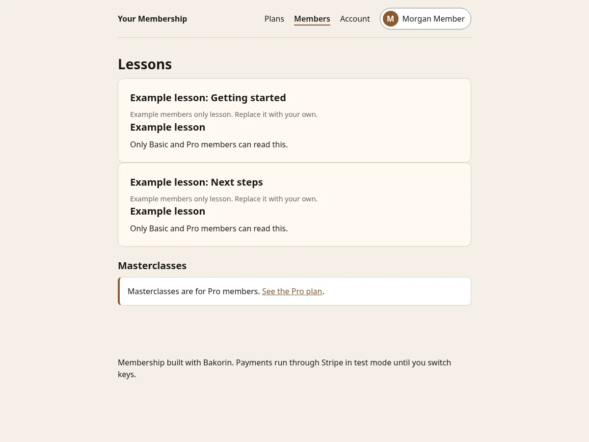

import { Aside } from "@astrojs/starlight/components";

`create-bakorin` can start a project from one of five templates. Each one has its own `app.yaml`, generated types, pages built with the [components](/docs/components/), and a `seed.ts` that loads example data. The same template works with `--frontend astro` and `--frontend next`.

```bash
bun run create my-blog --frontend astro --template blog --yes
bun run create my-site --frontend next --template marketing --yes
bun run create my-tool --frontend astro --template saas --yes
bun run create my-shop --frontend next --template store --yes
bun run create my-club --frontend astro --template membership --yes
```

| Template | Aliases | What you get |
|---|---|---|
| `blog` | | Posts, categories, private drafts, cover images |
| `marketing` | `site`, `marketing-site` | Page sections and a contact form that saves leads |
| `saas` | `internal`, `internal-tool`, `app` | Team projects, live updates, member, manager, and admin roles |
| `store` | `shop`, `ecommerce`, `ecom` | Products with photos and rich text descriptions, a cart, orders, and Stripe Checkout |
| `membership` | `members`, `subscriptions` | Plan tiers sold as Stripe subscriptions, members only content, and the Stripe customer portal |
| `todo` | | A private task list (the default, used by the example starters) |
| `auth-only`, `blank` | | Users and account pages only |

## Example data

Each of the five templates ships a `seed.ts`. Put an admin's email and password in `BAKORIN_ADMIN_EMAIL` and `BAKORIN_ADMIN_PASSWORD` in `.env`, start the API, then run it from the project folder:

```bash
bun seed.ts
```

Every record it adds is labeled as example data (titles start with "Example"), and images are plain striped placeholders. Running it twice adds nothing new. Edit or delete the examples before you launch.

<Aside type="note">
The store's example products and the membership's example plans have no prices. Set real prices on the Manage page (store) or in the admin (membership). A product without a price shows "Price not set", is left out of totals, and cannot be paid for.
</Aside>

## Blog

Posts and categories are public. Drafts are a separate entity that only admins can read, so an unpublished post can never leak through the API. Admins write at `/write`, upload a cover image, and press **Publish**, which copies the draft into `posts` with today's date and removes the draft. Signup is `invite`: readers do not need accounts.




| Path | What it does |
|---|---|
| `/` | Published posts with cover images |
| `/posts/:slug` | One post |
| `/categories/:slug` | Posts in a category |
| `/write` | Admins: new draft, drafts, published posts |
| `/write/:id` | Admins: edit, publish, or delete a draft |

Edit a published post in the admin UI at `/admin` on the API.

## Marketing site

Page content lives in `sections` (page, position, heading, body, and an optional button). The contact form saves to `leads`, which anyone can create (five per ten minutes per visitor) and only admins can read. Signup is `invite`; invite teammates from the admin UI.




| Path | What it does |
|---|---|
| `/` and `/about` | Sections for that page, in order |
| `/contact` | Contact form, saved as a lead |
| `/app/leads` | Admins: the leads, newest first |

## SaaS and internal tool

Everyone signed in sees every project. Members edit the projects they own; managers and admins edit and delete any project; admins also see the Team page. The dashboard is behind a `Gate` and shows project counts and a live list of team updates. The projects table and form share one live collection, and each name links to its edit page.


| Path | What it does |
|---|---|
| `/app` | Dashboard: project counts, live team updates |
| `/app/projects` | Projects table and form (live) |
| `/app/projects/:id` | Edit a project |
| `/app/team` | Admins: everyone and their role |

Change a person's role (`member`, `manager`, `admin`) in the admin UI.

## Store

Products and their photos are public, and descriptions are [rich text](/docs/app-yaml/#rich-text-fields). Signed in shoppers add products to a private cart and place an order. The order's lines, total, and Stripe fields are `writable: none`, so a shopper cannot set them: `hooks.ts` copies the cart into the order with the current prices right after it is saved, empties the cart, checks stock, and opens a Stripe Checkout Session for the exact total. Admins add and edit products, prices, and stock at `/manage`.





| Path | What it does |
|---|---|
| `/` | Products |
| `/products/:slug` | One product, add to cart |
| `/cart` | Cart and Place order |
| `/checkout/:id` | Order summary and Pay with Stripe |
| `/orders` | Your orders |
| `/manage` | Admins: add and edit products |

How an order gets paid:

1. The checkout page links to Stripe's hosted checkout page. Stripe sends the shopper back to `/checkout/:id`.
2. Stripe calls `POST /stripe/webhook` on the API. `hooks.ts` checks the `Stripe-Signature` header (HMAC SHA-256 over the timestamp and raw body, compared in constant time, 5 minute tolerance) and refuses anything else with a 400.
3. A verified `checkout.session.completed` marks the order paid only when its session id, amount, and currency match the order. Stock goes down by the quantities bought, and a receipt email goes out through the [mail outbox](/docs/email/) with an idempotency key.
4. Each Stripe event id is saved in the `stripeEvents` entity in the same transaction, so a retried or replayed event changes nothing. `checkout.session.expired` cancels the order.

The return page never marks an order paid. It shows "confirming your payment" until the webhook lands.

See [Stripe setup](#stripe-setup) for keys and the webhook endpoint.

## Membership

Plans are public. A signed in user picks one and pays on Stripe's hosted checkout page in subscription mode. Verified subscription webhooks set the user's `role` to the plan tier (`basic` or `pro`), keep `subscriptionStatus` and `currentPeriodEnd` up to date, and set the role back to `user` when the subscription ends. Members cannot change any of it: those fields are `writable: none` or `writable: admin`.

`app.yaml` rules do the gating, so the API refuses everyone else no matter which page asks:

```yaml
lessons:
  policies:
    read: [role(basic), role(pro), admin]
masterclasses:
  policies:
    read: [role(pro), admin]
```





| Path | What it does |
|---|---|
| `/` | Plans and Join |
| `/join/:id` | Opens Stripe Checkout for a plan |
| `/members` | Lessons for members and masterclasses for Pro |
| `/account` | Your plan, status, and Manage billing (Stripe customer portal) |

Put each plan's Stripe Price id in its `stripePriceId` field in the admin. The role rides in the session token, so `/account` renews the session once after checkout to pick up the new role. Plan changes and cancellations made in the customer portal arrive as `customer.subscription.updated` and `customer.subscription.deleted` and take effect the next time the session renews.

## Stripe setup

The store and membership templates call the Stripe API with `fetch`, so there is no SDK to install. Use **test mode** keys while you build, and never commit a real key. `.env.example` lists the variables with empty values:

| Variable | What it is |
|---|---|
| `STRIPE_SECRET_KEY` | Secret key (`sk_test_...`). Server only. Without it the app runs and checkout says payments are not set up. |
| `STRIPE_WEBHOOK_SECRET` | Signing secret of your webhook endpoint (`whsec_...`) |
| `STRIPE_PUBLISHABLE_KEY` | Publishable key. Hosted checkout does not need it; it is there for Stripe.js if you add it. |
| `SITE_URL` | Your web app, where Stripe sends people back to |
| `STORE_CURRENCY` | Store only. Defaults to `usd`. |

While you develop, forward events to the API with the Stripe CLI and copy the signing secret it prints into `STRIPE_WEBHOOK_SECRET`:

```bash
stripe listen --forward-to localhost:4371/stripe/webhook
```

In production, add an endpoint for `https://<your API>/stripe/webhook` in the Stripe dashboard. The store needs `checkout.session.completed` and `checkout.session.expired`. The membership template needs `checkout.session.completed`, `customer.subscription.created`, `customer.subscription.updated`, and `customer.subscription.deleted`. Pay with [Stripe's test cards](https://docs.stripe.com/testing).

## Change a template

- Site name, header links, protected paths, and where people land after signing in are in `lib/site.ts` (Next) or `src/lib/site.ts` (Astro).
- After you change `app.yaml`, regenerate the types: `bunx bakorin typegen -o web/src/lib/bakorin.gen.ts` (Astro) or `-o web/lib/bakorin.gen.ts` (Next).
- Each project's `web/README.md` lists its pages.
