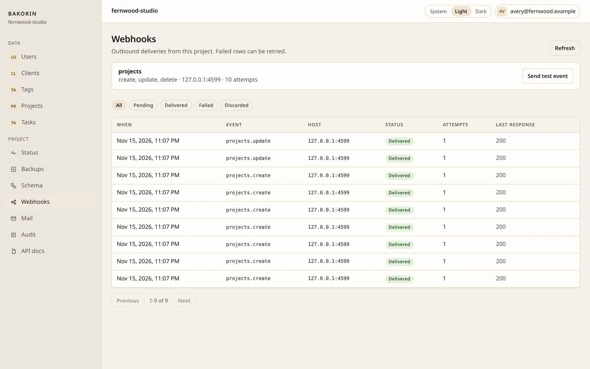

Bakorin posts JSON to your URL after a successful create, update, or delete. Delivery is durable: each event is written to the `_bakorin_webhook_outbox` table in the same database transaction as the record change, then a worker POSTs it with retries. If the change rolls back, no delivery is queued. If the outbox write fails, the change rolls back too.



## Setup

```yaml title="app.yaml"
runtime:
  webhooks:
    retainDays: 30          # delivered rows older than this are deleted
webhooks:
  - entity: leads           # or "*" for every entity
    events: [create, update, delete]
    url: ${WEBHOOK_URL}
    secret: ${WEBHOOK_SECRET}
    maxAttempts: 10         # default 10
    timeoutMs: 10000        # default 10000
```

Restart the server after you change webhook settings. The admin UI (Project, then Webhooks) lists deliveries, retries failed rows, and sends test events.

## Payload

```json
{
  "event": "leads.create",
  "entity": "leads",
  "op": "create",
  "before": null,
  "after": { "id": "...", "company": "Northwind Studio" },
  "actor": { "id": "...", "role": "admin" }
}
```

`before` is null on create. `after` is null on delete. Test events also set `"test": true`.

Password hashes and any field marked `secret: true` are stripped from `before` and `after`. `actor` is only `{ id, role }`.

## Headers

| Header | Meaning |
| --- | --- |
| `content-type` | `application/json` |
| `x-bakorin-event` | `entity.op`, for example `leads.create` |
| `x-bakorin-delivery` | Stable outbox id. Retries reuse it |
| `x-bakorin-timestamp` | ISO 8601 time of this attempt. Each retry gets a fresh timestamp and signature |
| `x-bakorin-signature` | `sha256=<hex>` when `secret` is set |

## Verify the signature

The HMAC covers `timestamp + "." + raw body`. Use the raw bytes you received, not a re-serialized object, and reject old timestamps to block replays.

```js title="verify.js"
import { createHmac, timingSafeEqual } from "node:crypto";

export function verifyBakorinWebhook(secret, timestamp, rawBody, signatureHeader) {
  const expected = "sha256=" + createHmac("sha256", secret).update(`${timestamp}.${rawBody}`).digest("hex");
  const a = Buffer.from(expected);
  const b = Buffer.from(signatureHeader ?? "");
  if (a.length !== b.length || !timingSafeEqual(a, b)) {
    return false;
  }
  const ageMs = Math.abs(Date.now() - Date.parse(timestamp));
  return Number.isFinite(ageMs) && ageMs < 5 * 60 * 1000;
}
```

```js
const rawBody = await request.text();
const ok = verifyBakorinWebhook(
  process.env.WEBHOOK_SECRET,
  request.headers.get("x-bakorin-timestamp"),
  rawBody,
  request.headers.get("x-bakorin-signature"),
);
```

## Retries and cleanup

- Each POST uses `timeoutMs` (default 10 seconds).
- Failures retry with exponential backoff (`100ms * 2^attempts`), capped at 60 seconds.
- Deliveries are grouped by receiving host. Each host gets its events in order, one at a time, and up to 8 hosts are sent to at once, so a slow or down receiver does not delay the others.
- After `maxAttempts` (default 10) the row is marked `failed` and is not retried automatically.
- The last HTTP status and a short error are stored on the row.
- Admins can retry a failed row from the Webhooks page.
- Delivered rows older than `runtime.webhooks.retainDays` (default 30, or `BAKORIN_WEBHOOK_RETAIN_DAYS`) are deleted. Failed rows are kept.
- Delivery takes a database lease (`webhook-dispatcher`), so two instances do not double send.

## Zapier, Make, and n8n

**Zapier.** Create a Catch Hook, paste its URL into `webhooks[].url`, and set `secret` if you verify signatures in a Code step. Filter on `event` so a Zap handles only, for example, `leads.create`.

**Make.** Add a Custom Webhook module, copy its URL, and parse the JSON. Use `x-bakorin-delivery` as an idempotency key if a scenario must not run twice.

**n8n.** Add a Webhook node (POST), put its URL in `app.yaml`, and optionally a Crypto node that checks the HMAC. Filter on `body.event` or `body.test` so test clicks from the admin UI do not reach production paths.
